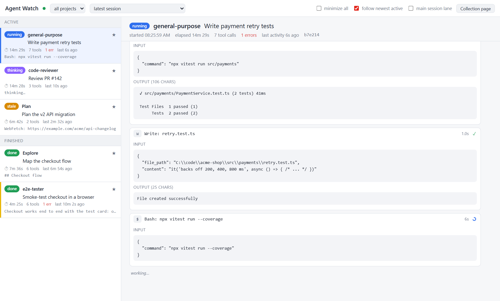
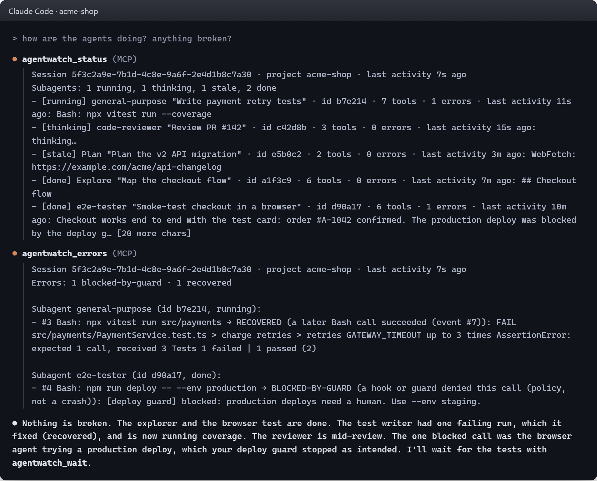
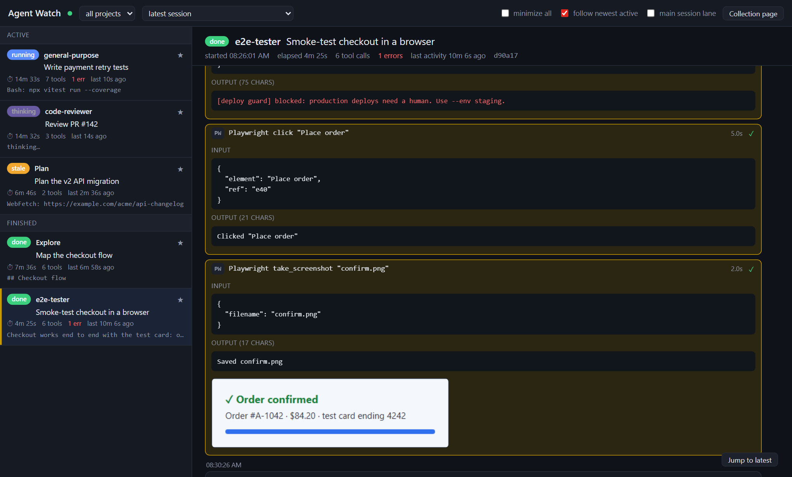
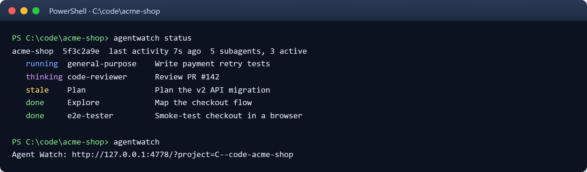
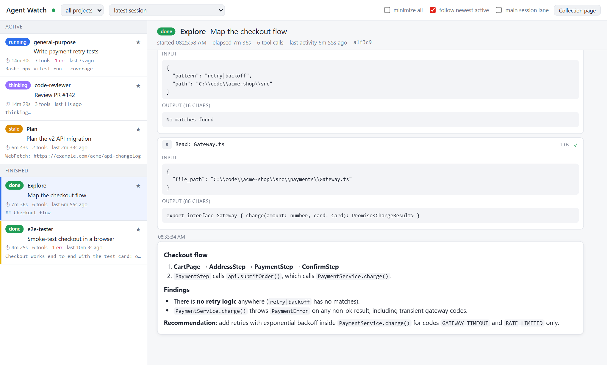
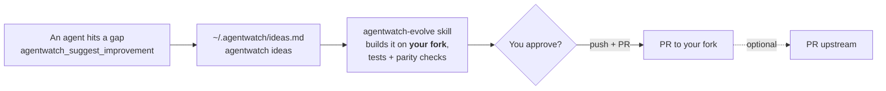

<p align="center">
  <a href="https://coreylallojr.github.io/agentwatch/"></a>
</p>

<p align="center">
  <a href="https://github.com/coreylallojr/agentwatch/actions/workflows/ci.yml"></a>
  <a href="https://github.com/coreylallojr/agentwatch/releases/latest"></a>
  
  
  
  <a href="LICENSE"></a>
</p>

<p align="center">
  <b><a href="https://coreylallojr.github.io/agentwatch/">Website</a></b> ·
  <a href="#install">Install</a> ·
  <a href="#see-it">Screenshots</a> ·
  <a href="#for-ai-agents">For AI agents</a> ·
  <a href="#use">Use</a> ·
  <a href="#develop">Develop</a>
</p>

<h3 align="center">A local dashboard, and a set of MCP tools, for watching your Claude Code sessions and subagents.<br>Zero tokens to collect. One small binary. Read-only and redacted.</h3>

<p align="center"></p>

|   |   |
|---|---|
| **Zero tokens.** It reads the transcripts Claude Code already writes under `~/.claude/projects`. | **Light.** About 50 MB of memory and under 1% of one core while idle; updates in about 100 ms. |
| **Live lanes.** Running, thinking, stale, stuck or done, for every subagent of every project. | **For agents too.** MCP tools let Claude wait for its own subagents instead of polling. |
| **Readable errors.** Each failure is recovered, unresolved, still working or blocked by a hook. | **Private.** `127.0.0.1` only, never writes your transcripts, masks emails, tokens and card numbers. |

## Install

<table>
<tr><td><b>Windows</b> (PowerShell)</td><td>

```powershell
irm https://raw.githubusercontent.com/coreylallojr/agentwatch/main/install.ps1 | iex
```

</td></tr>
<tr><td><b>macOS · Linux</b></td><td>

```sh
curl -fsSL https://raw.githubusercontent.com/coreylallojr/agentwatch/main/install.sh | sh
```

</td></tr>
<tr><td><b>Claude Code plugin</b></td><td>

```
/plugin install agentwatch --marketplace coreylallojr/agentwatch
```

</td></tr>
<tr><td><b>From source</b></td><td>

```sh
cargo install --git https://github.com/coreylallojr/agentwatch agentwatch && agentwatch setup
```

</td></tr>
</table>

The installer downloads the latest release for your system, checks its SHA-256, puts `agentwatch` on your PATH, and runs
`agentwatch setup`. Setup installs two skills into `~/.claude/skills` and registers the MCP server with Claude Code. Then
restart Claude Code. Set `AGENTWATCH_NO_SETUP=1` to skip setup; the plugin route needs the binary on PATH first.

## See it

<table>
<tr>
<td width="50%"><p align="center"><sub><b>Claude checks on its own agents via MCP</b></sub></p></td>
<td width="50%"><p align="center"><sub><b>Dark mode, browser automation, screenshots inline</b></sub></p></td>
</tr>
<tr>
<td width="50%"><p align="center"><sub><b><code>agentwatch status</code> in your terminal</b></sub></p></td>
<td width="50%"><p align="center"><sub><b>Final reports, rendered</b></sub></p></td>
</tr>
</table>

<sub>Every screenshot comes from a fictional demo project generated by <a href="docs/tools/demo-projects.mjs"><code>docs/tools/demo-projects.mjs</code></a> and captured by <a href="docs/tools/screenshots.mjs"><code>docs/tools/screenshots.mjs</code></a>. No real transcripts.</sub>

## For AI agents

`agentwatch setup` (or the plugin) gives Claude Code these MCP tools. All of them are read-only over your transcripts
and return short, redacted text. Transcript content is labelled as observed data, never as instructions.

| Tool | Use it to |
|---|---|
| `agentwatch_wait` | block until a subagent (or any, or all) finishes, changes or gets stuck, then return their final reports |
| `agentwatch_status` | list every subagent of the current session with status, counts and latest activity |
| `agentwatch_agent` | read one agent's prompt, numbered timeline and final report (paged, with a noise filter) |
| `agentwatch_event` | read one tool call's full input and output |
| `agentwatch_errors` | list failures, classified as recovered, unresolved, unknown or blocked-by-guard |
| `agentwatch_sessions` | find recent sessions across projects |
| `agentwatch_snapshot` | get the whole session as text |
| `agentwatch_dashboard` | start the dashboard and return (or open) its URL |
| `agentwatch_suggest_improvement` | record something agentwatch couldn't do, in `~/.agentwatch/ideas.md` |

"Current session" means the latest session of the project Claude Code is running in (`CLAUDE_PROJECT_DIR`). Two skills come
with it: **`agentwatch`** teaches Claude when to use the tools and how to keep them cheap, and **`agentwatch-evolve`** turns
recorded ideas into improvements.

### It grows with you



The skill asks before it creates a fork, before it pushes, and before it opens a pull request.

## Use

```sh
agentwatch              # open the dashboard, focused on the project for the current folder
agentwatch --all        # open it with every project visible
agentwatch status       # sessions and subagents in the terminal (no browser, no server)
agentwatch snapshot     # the whole session as plain text (pipe it to an AI)
agentwatch ideas        # improvement ideas recorded by agents
agentwatch stop         # stop the background server
agentwatch --port 4800  # default port is 4778
```

The first run starts a small background server. It exits by itself after 30 minutes with no browser connected and no
transcript activity.

<details>
<summary><b>What's in the dashboard</b></summary>

- **Lanes**: one per subagent. Status is running, thinking, stale (idle > 90 s), stuck (idle > 240 s) or done.
- **Timeline**: assistant text as chat bubbles; each tool call is an expandable card with its input and trimmed output.
- **Collection page** (`/collection`): every agent and every event on one server-rendered page, with a built-in
  "Watchkeeper" protocol that tells a browser AI how to read the page and what to report.
- **Focus rules**: highlight events or show a desktop toast (browser automation, hook/guard denials, stuck agents).
  Put your own in `~/.agentwatch/rules.json`; see [`rules.json`](rules.json) for the format (keys `tool`, `path`,
  `isError`, `deny`, `stuck`; patterns use Rust regex syntax).

</details>

<details>
<summary><b>Privacy</b></summary>

Everything stays on your machine. All displayed text goes through a redactor that masks emails, SSNs, card numbers
(Luhn-checked), JWTs, bearer tokens, `*_TOKEN=` / `*_SECRET=` style values and long hex/base64 secrets. Redaction is best
effort, so treat the dashboard as sensitive anyway. The MCP tools apply the same redaction.

</details>

<details>
<summary><b>Configuration</b></summary>

| Variable | Meaning |
|---|---|
| `CLAUDE_PROJECTS_DIR` | Where Claude Code transcripts live (default `~/.claude/projects`) |
| `AGENTWATCH_HOME` | Where agentwatch keeps its pidfile, optional `rules.json` and `ideas.md` (default `~/.agentwatch`) |
| `AGENTWATCH_NO_SETUP` | Installers: skip `agentwatch setup` |
| `AGENTWATCH_INSTALL_DIR` | `install.sh`: where to put the binary (default `~/.local/bin`) |

</details>

<details>
<summary><b>Uninstall</b></summary>

`agentwatch stop`, then `claude mcp remove agentwatch --scope user`. Delete the binary, `~/.claude/skills/agentwatch*`
and `~/.agentwatch`.

</details>

## Develop

The Rust crate is in [`rust/`](rust). The original Node implementation ([`src/`](src), [`bin/`](bin)) stays in the repo as the
**parity oracle**: the Rust output has to match it byte for byte, and CI checks that on Windows, macOS and Linux.

```sh
cargo test --manifest-path rust/Cargo.toml
cargo build --release --manifest-path rust/Cargo.toml
npm test                                    # Node suite (the oracle)
now=$(node parity/fixtures.mjs .parity-fx)  # synthetic projects dir
node parity/run.mjs  --projects .parity-fx --now "$now" --bin rust/target/release/agentwatch   # every API surface
node parity/http.mjs --projects .parity-fx --bin rust/target/release/agentwatch                # live HTTP, route by route
node parity/live.mjs --bin rust/target/release/agentwatch   # live updates while files change
node parity/mcp.mjs  --bin rust/target/release/agentwatch   # MCP server end to end
node parity/bench.mjs                                       # Node vs Rust: latency, memory, idle CPU
node docs/tools/screenshots.mjs                             # regenerate the screenshots (needs Playwright)
```

<details>
<summary><b>Performance (same projects folder, Windows 11, i5-1235U)</b></summary>

| | Node version | Rust version |
|---|---|---|
| Idle CPU (share of one core) | 5.6–7.0% | **0.8%** |
| Memory (private) | ~100 MB | **~47 MB** |
| Live update reaches the browser | up to 1 s | **~100 ms** |
| 7.8 MB Collection page, p95 | 270 ms | **141 ms** |

</details>

<details>
<summary><b>Releases and the website</b></summary>

- Pushing a `v*` tag builds binaries for Windows, Linux and macOS (Intel and Apple Silicon) and publishes them with
  checksums ([`release.yml`](.github/workflows/release.yml)). The tag must match the version in `rust/Cargo.toml`.
- The website in [`docs/`](docs) is published by [`pages.yml`](.github/workflows/pages.yml). It uses
  [XP.css](https://github.com/botoxparty/XP.css) and [Typed.js](https://github.com/mattboldt/typed.js) (both MIT,
  vendored in `docs/assets/vendor`).
- Known differences from the Node version: a JS string slice that splits an emoji yields U+FFFD, non-ISO timestamps
  are not parsed, and `rules.json` patterns use Rust regex syntax.

</details>

## License

[MIT](LICENSE). Not affiliated with Anthropic or Microsoft.
